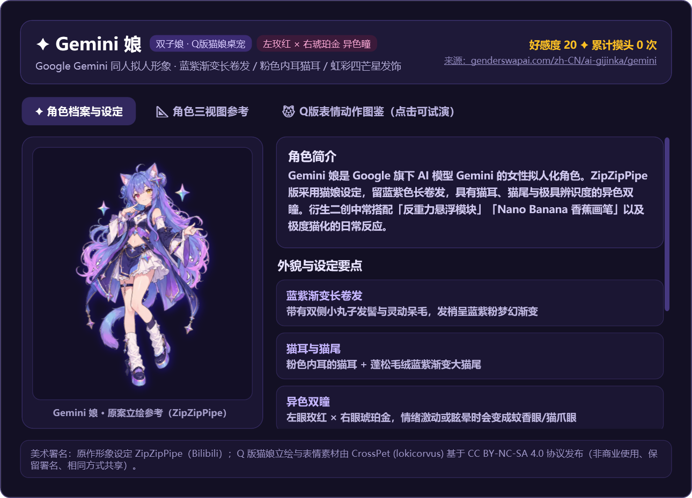
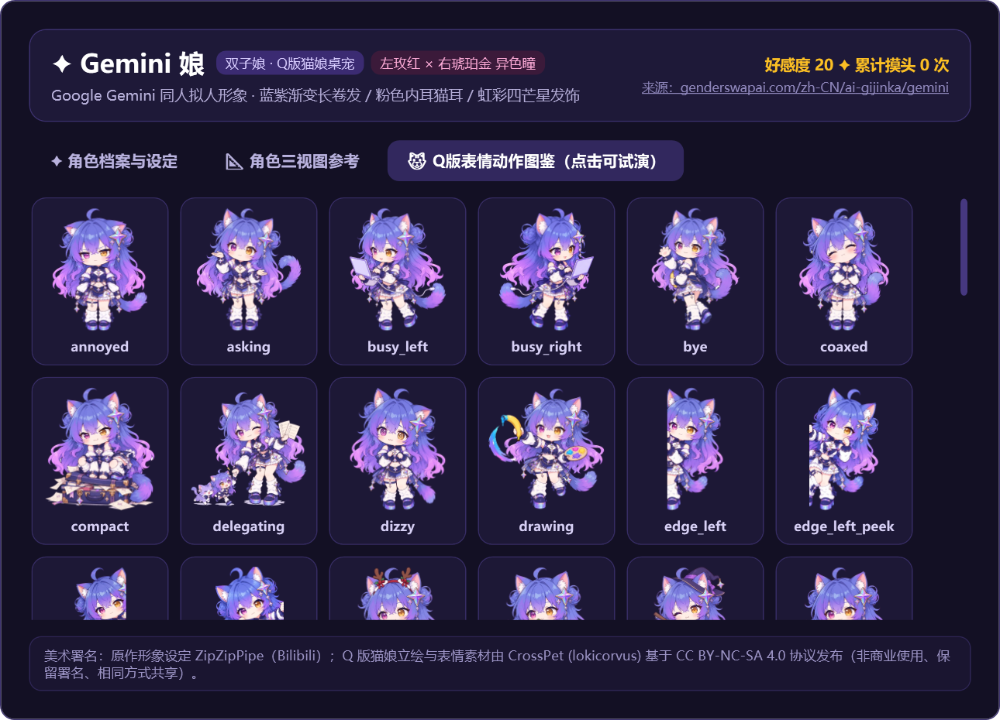
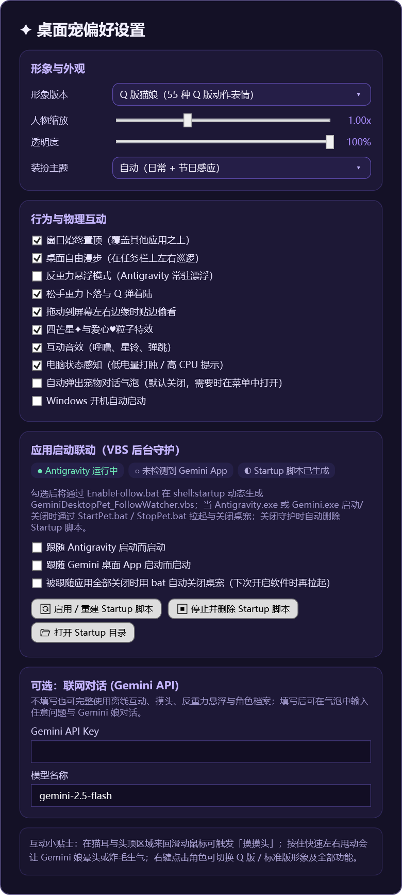

# Gemini 娘 桌面萌宠

基于 [Gender Swap AI · Gemini 娘角色档案](https://genderswapai.com/zh-CN/ai-gijinka/gemini) 设定的 Windows 原生透明桌面宠物，支持 **Q 版（默认） / 标准立绘版** 双形态切换。

## 运行效果预览


| 角色档案与设定 | Q 版表情动作图鉴 |
| :---: | :---: |
|  |  |

<details>
<summary>展开查看：偏好设置与 VBS 应用联动界面</summary>

<p align="center">
  
</p>

</details>

## 核心功能

- **双形态与自然行走**：内置 55 种 Q 版动作表情与标准版全比例三视图立绘；自由漫步时启用自然骨骼步态动画，边缘停靠时自动贴边偷看。
- **暗夜星光深色主题**：菜单、弹窗与设置界面统一采用深紫星光透明风格。
- **应用联动启停**：支持跟随 `Antigravity` 与 `Gemini` 桌面 App 自动启动与关闭。
- **拟态物理互动**：摸头呼噜增加好感、拖曳甩动反应、反重力悬浮、屏幕边缘贴靠与自由漫步。
- **Antigravity 额度看板**：双击宠物或通过右键 / 托盘菜单查看当前账号剩余额度与重置时间。
- **角色档案与 AI 对话**：内置 **角色档案图鉴** 与 **AI 对话气泡**（气泡默认关闭，可从右键或托盘菜单打开；支持离线回复及接入 Gemini API Key）。

```shell
# 使用 dotnet CLI 或 Visual Studio MSBuild 构建 Release
dotnet build GeminiDesktopPet.slnx -c Release

# 运行或打包发布独立 ZIP（输出至 publish）
.\BuildRelease.bat
```

> 角色设定、素材来源与开源协议详见 [CREDITS.md](CREDITS.md) 与 [LICENSE](LICENSE)。
