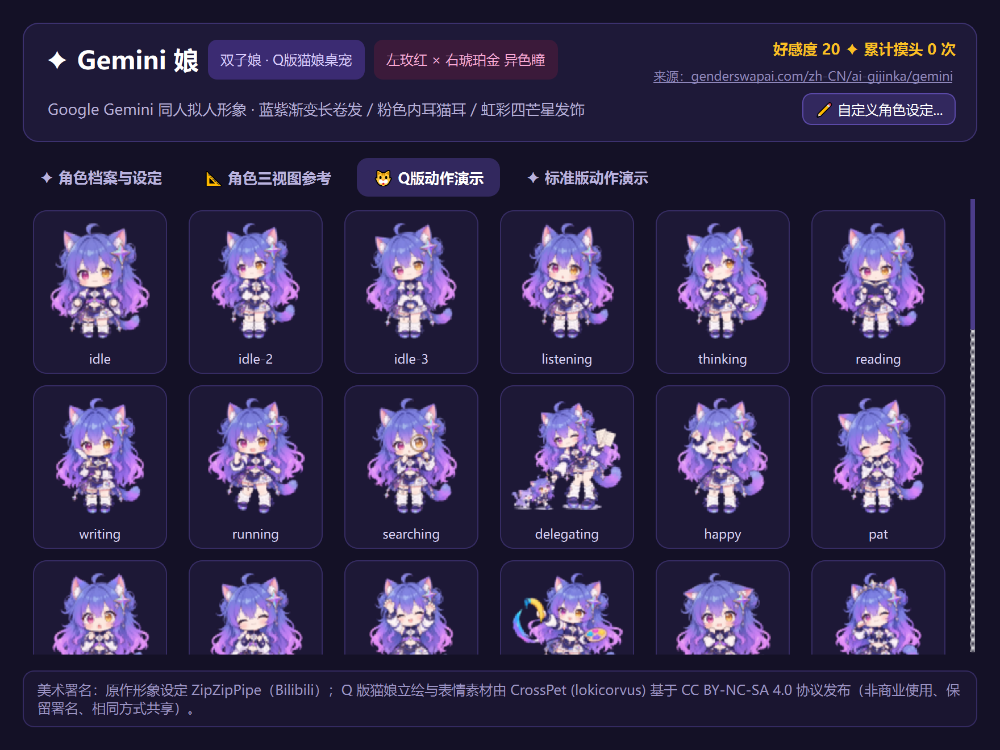
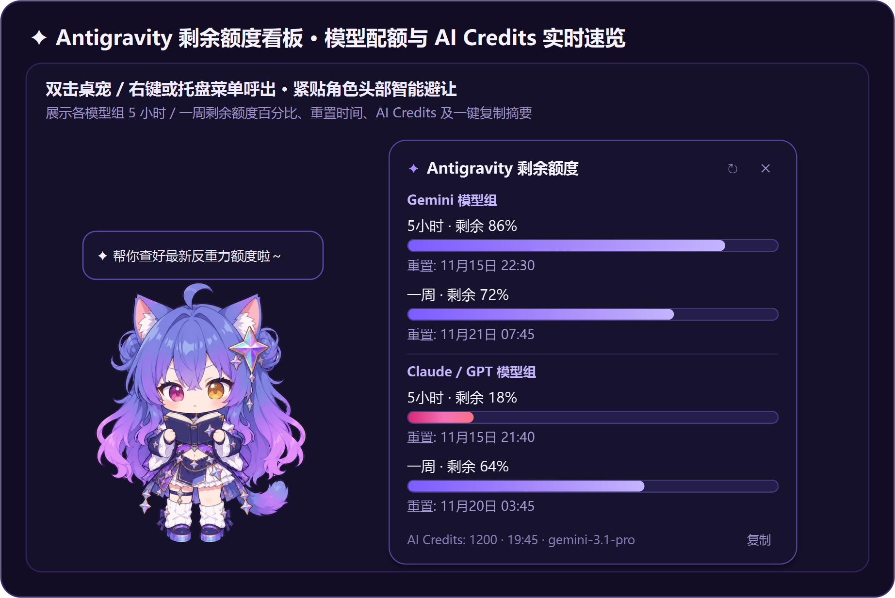

# Gemini 娘 桌面萌宠

基于 [Gender Swap AI · Gemini 娘角色档案](https://genderswapai.com/zh-CN/ai-gijinka/gemini) 设定的桌面宠物，支持 **Q 版（默认） / 标准立绘版** 双形态切换。

## 运行效果预览

| 角色档案与设定 | Q 版表情动作图鉴 |
| :---: | :---: |
|  |  |

| Antigravity 剩余额度看板 |
| :---: |
|  |

展开查看：设置

  

## 核心功能

- **双形态桌宠**：Q 版与标准立绘一键切换，自由漫步、贴边停靠。
- **桌面互动**：摸头、拖拽、反重力悬浮等拟态反馈，附带好感度。
- **应用联动**：跟随 Antigravity 与 Gemini 桌面端自动启停。
- **Antigravity 额度查询**：一键呼出额度与重置时间，低余量提醒，可复制摘要。
- **Antigravity 应用对话同步**：开启后 Antigravity 应用的实时对话消息会显示在桌宠气泡里。
- **角色档案**：内置角色图鉴与档案，支持自定义角色设定。
- **聊天模式**：桌面右键或托盘菜单一键打开聊天窗口，支持多轮对话、历史会话与窗口尺寸切换；默认离线陪伴，填入 Gemini API Key 后可接入官方 Gemini AI 模型聊天，并随时切换模型。

## 配置与清理

- **配置目录**：设置、角色档案与日志保存在 `%USERPROFILE%\.GeminiDesktopPet`；个人 API Key 仅存本地，请勿分享配置文件。
- **一键清理**：发布包附带 `CleanConfig.exe`；源码运行可用 `python clean_config.py`，加 `-y` 免确认。

## 问题反馈

遇到闪退、联动失效、额度读取失败或更新报错，请到 [GitHub Issues](https://github.com/xiaoxindada/GeminiDesktopPet/issues) 反馈：

1. 在 **设置 → 日志与排查** 或右键菜单开启运行日志，复现一次问题。
2. 提交前先脱敏个人路径、账号与凭据等敏感信息。

## 开发与打包

本地开发、IDE 配置与打包详见 [BUILD.md](BUILD.md)。

> 角色设定、素材来源与开源协议见 [CREDITS.md](CREDITS.md) 与 [LICENSE](LICENSE)。
